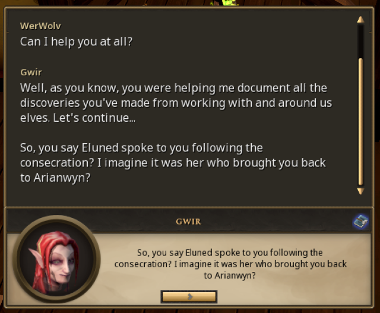

# RuneScape3 Conversation History

This plugin adds a conversation history button to each dialog interface that allows you to read up on the conversation up until this point.

## License

All source code in this repository (except for where explicitly noted otherwise) is licensed under the terms of the GPLv2, with exemptions noted below.
Assets are licensed by their respective owner.

You can find a copy of the license in the LICENSE.md file.

Exemptions:
- Jagex is exempt from GPLv2 licensing and may (at their option) instead license any source code authored for this project under the Zero-Clause BSD license.
